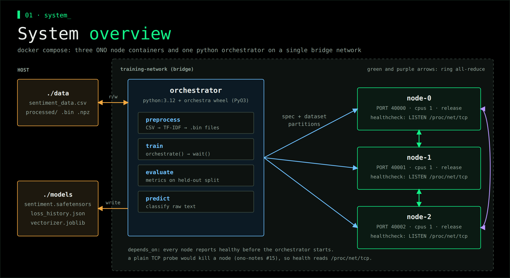
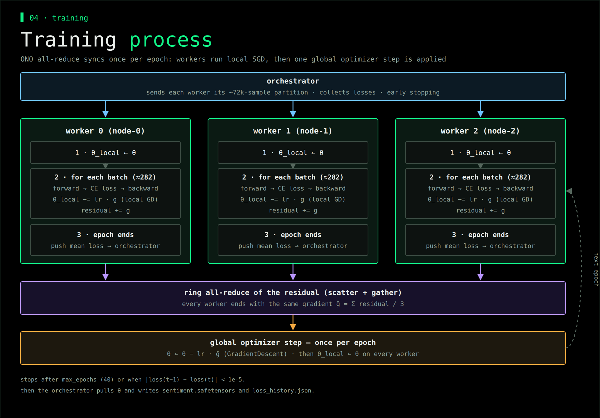

# Simple sentiment classifier

Neural network sentiment classifier trained using [Oxidized Neural Orchestra](https://github.com/lminervino18/oxidized-neural-orchestra).

```bash
.
├── data                 # Input training and testing data
├── docker-compose.yml
├── external             #  Libs
│   └── ono
├── models               # Trained models in .safetensors format
├── README.md
└── sentiment-classifier # Model training and inference
```

## Vendored libs

After cloning fetch the external libs:

```bash
git submodule update --init --recursive
```

## Dataset

Used dataset can be downloaded from [kaggle](https://www.kaggle.com/datasets/abdelmalekeladjelet/sentiment-analysis-dataset) and placed into the `data/` folder.

## Usage

Everything runs in Docker (3 ONO node containers + a Python orchestrator container)..

```bash
# 1. CSV -> TF-IDF features (2000 by default) -> f32 binaries + held-out 10% test split
docker compose run --rm --build --no-deps orchestrator preprocess

# 2. Distributed training: all-reduce
docker compose up --build --abort-on-container-exit orchestrator

# 3. Evaluate on the test split / classify text
docker compose run --rm --no-deps orchestrator evaluate
docker compose run --rm --no-deps orchestrator predict "love this phone" "worst update ever"

docker compose down
```

Outputs can be found in `models/`: `sentiment.safetensors`, `loss_history.json`, `vectorizer.joblib`.

## Training configuration

Set through environment variables (defaults in `sentiment-classifier/src/sentiment_classifier/config.py`): `OPTIMIZER` (`gd` | `momentum` | `adam`), `LR`, `MOMENTUM`, `MAX_EPOCHS`, `BATCH_SIZE`, `EARLY_STOPPING_TOLERANCE`, `N_FEATURES`.

Defaults are plain gradient descent, `LR=1.0`, up to 40 epochs. ONO applies the optimizer once per epoch, so Adam learns very slowly (see `docs/ono-notes.md` #16).

To compare learning rates on a subset without touching the full data or model (uses `data/trial` and `models/trial`):

```bash
./scripts/lr_trial.sh 0.5 1.0 2.0
```

More in `docs/`.

## Architecture





All diagrams are in [`docs/img`](docs/img) and generated from [`docs/diagrams/index.html`](docs/diagrams/index.html).
