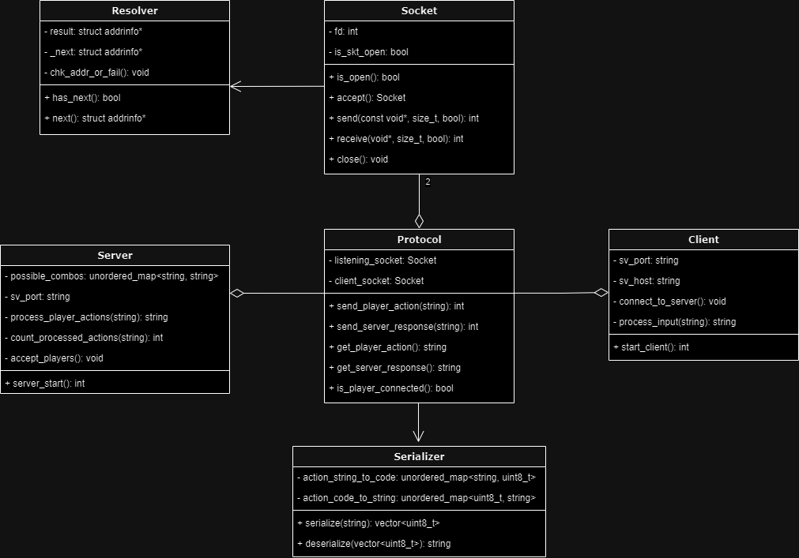

# Sockets

⚔️ Maximo Utrera - 109651

## Cambios (en base a las correcciones)

* La clase socket utiliza un resolver para obtener la ip del servidor.
* La clase protocolo ya no tiene un serializador como miembro, sino que usa este como un metodo estatico.
* Siempre que se tenga el largo de un mensaje a enviar/recibir, se envia/recibe en una sola llamada al socket (en lugar 
de byte a byte).
* Se agrego una macro CONNECTION_TERMINATED para terminar el programa de forma gracefully cuando un error es
irrecuperable o cuando la coneccion es terminada (de buena manera) por una de las dos partes (antes solo se devolvia un
string vacio).
* Los valores del serializer ahora usan uint8_t para representar los bytes de los mensajes 
(ej. JUMP:string -> 0x01:uint8_t).
* La funcion de busqueda de combos en el servidor ahora maneja objetos del dominio y no conoce nada de la representacion
de los mensajes (ej. mapea "JUMP JUMP HIT" a "UPPERCUT").
A su vez su nueva implementacion ya no usa funciones como memcmp.

## Overview

El trabajo practico fue resuelto utilizando un total de 6 clases principales que interactuan
entre si para cumplir con el comportamiento esperado. Estas son:

* **Socket**

Esta clase encapsula la funcionalidad de los sockets para asi abstraer al usuario de
la complejidad de la API de sockets. Permite la creacion de un socket y la coneccion a un servidor, asi como el envio
y recepcion de mensajes.

* **Resolver**

Es utilizada por el socket para resolver el nombre del servidor a su direccion IP correspondiente y tambien
maneja que tipo de socket se va a usar (TCP) y que tipo de direccionamiento (IPv4).

*Esta clase fue implementada por [eldipa](https://github.com/eldipa/sockets-en-cpp) cuyo codigo tiene licencia MIT*

* **Protocol**

Esta clase encapsula la funcionalidad de los protocolos de comunicacion entre
procesos y tiene como componentes fundamentales un socket de aceptacion de clientes y un socket para el cliente in-game.
En este caso, se implementa un protocolo de comunicacion donde un cliente envia mensajes con
acciones de juego representadas en 1 byte y un byte de terminacion al final, y el servidor responde
con mensajes donde los primeros 2 bytes es el largo del mensaje y el resto es un string.

* **Serializer**

Esta es una clase *estatica* usada por la clase protocolo para facilitar la serializacion y deserializacion de mensajes.

* **Server**

La funcionalidad principal de esta clase es recibir los mensajes de los jugadores y decidir
las acciones que este debe realizar, teniendo en cuenta posibles combos. Para lograr este grado de abstraccion
es que tiene como componente un protocolo de comunicacion.

* **Client**

La funcionalidad principal de esta clase es enviar los mensajes del jugador al servidor y recibir las respuestas
para comunicarle al jugador sus acciones y combos. Envia mensajes a travez de su componente protocolo de comunicacion.

## Diagrama de clases

###### Si no se puede ver la imagen, ver la carpeta img y abrir Sockets.png
###### o clickee [aqui](https://github.com/Taller-de-Programacion-TPs/sockets-2024c1-maxogod/blob/main/img/Sockets.png)

