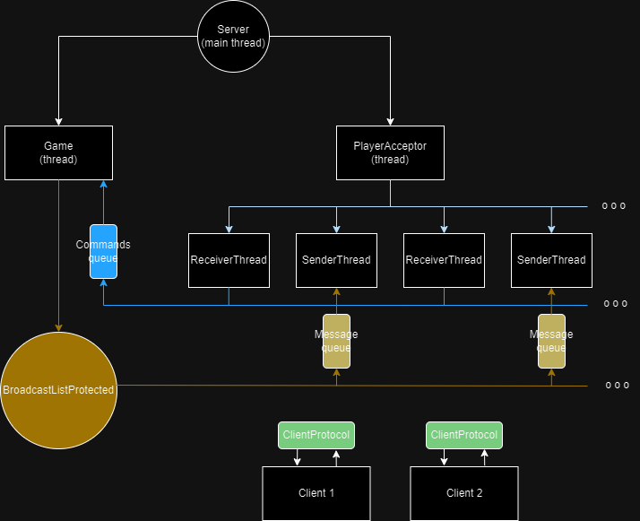

# Threads

⚔️ Maximo Utrera - 109651

## Cambios (en base a las correcciones)

* Cambio del uso de getline por el operador >> sobre std::cin. ***issues #1, #2***.
* Creacion de un objeto GameEvent que se puede imprimir, y ya no se manejan vectores de uint8. ***issues #3, #15***.
* Creacion de un enum Command que tiene NONE y ATTACK, y ya no se maneja un uint8 como accion del jugador
  ni tampoco se usa Serializer ***issues #4, #14***.
* Se usa htons y ntohs correctamente y no se hace manejo de bits. ***issues #5***.
* Cambio de lugar definiciones no comunes de common_src/defs.h a su ubicacion correcta. ***issues #6***.
* Arreglo de mal uso del heap. ***issues #7, #11, #13***.
* Ya no se puede crear sockets sin incializar, y se atrapan las exepciones correctas. ***issues #8, #9***.
* El receiver ahora crea el protocolo en su Member Initialization List. ***issues #10***.
* Agregado del metodo reap_dead_players para que la lista de jugadores no crezca indefinidamente. ***issues #12***.
* El sender agrega su message_queue a la broadcast_list en su constructor y la quita en su destructor.
  Es decir BroadcastListProtected ahora tiene un metodo remove_queue. ***issues #16***.
* Creacion de una clase Enemy con responsabilidad propia. ***issues #17***.
* Ahora se pueden ejecutar multiples commands en una sola iteracion del gameloop. ***issues #18***.

## Overview

Las clases implementadas para el desarrollo de este trabajo practico:

### Clases common

* **Socket**

Esta clase encapsula la funcionalidad de los sockets para asi abstraer al usuario de
la complejidad de la API de sockets. Permite la creacion de un socket y la coneccion a un servidor, asi como el envio
y recepcion de mensajes.

* **Resolver**

Es utilizada por el socket para resolver el nombre del servidor a su direccion IP correspondiente y tambien
maneja que tipo de socket se va a usar (TCP) y que tipo de direccionamiento (IPv4).

*Esta clase fue implementada por [eldipa](https://github.com/eldipa/sockets-en-cpp) cuyo codigo tiene licencia MIT*

* **Queue**

Implementacion de cola thread-safe con metodos bloqueantes y no bloqueantes para push y pop.

*Esta clase fue implementada por [eldipa](https://github.com/eldipa/hands-on-threads) cuyo codigo tiene licencia MIT*

* **Thread**

Clase para abstraer la creacion de threads y manejar su ejecucion. Se usa herencia para customizar que se
ejecuta en el thread.

*Esta clase fue implementada por [eldipa](https://github.com/eldipa/hands-on-threads) cuyo codigo tiene licencia MIT*

* **GameEvent**

Esta clase es una clase printeable la cual representa un evento del juego como la muerte o vuelta a vida de un enemigo.

### Clases server

* **Server**

Esta clase se encarga de lanzar los threads de Game y PlayerAcceptor y de esperar por stdin una 'q' para
cerrar ordandamente todo el programa.

* **Game**

Es una clase que hereda de Thread y se encarga de manejar el gameloop.
Esta escucha los mensajes que le llegan a una command queue que es donde llegan las acciones de los jugadores,
tambien cada 15 iteraciones del juego se revive un enemigo muerto.

* **Enemy**

Es una clase usada en el gameloop que encapsula la funcionalidad de morir y revivir de un enemigo.

* **PlayerAcceptor**

Es una clase que hereda de Thread y se encarga de aceptar las conexiones de los jugadores y lanzar un thread
receiver y sender por cada jugador conectado.

* **ReceiverThread**

Es una clase que hereda de Thread y se encarga de recibir los mensajes de los jugadores y ponerlos en la 
command queue.

* **SenderThread**

Es una clase que hereda de Thread y se encarga de sacar mensajes de broadcast de la cola de mensajes de
el cliente en cuestion, y envia dichos mensajes con el protocolo.

* **ServerProtocol**

Esta clase encapsula la funcionalidad de comunicacion a través de un socket con los clientes.

* **BroadcastListProtected**

Es una clase monitor thread-safe para encapsular un objeto compartido entre threads,
en este caso una lista colas de mensajes de los clientes. Se encarga de encolar los mensajes del server
en las colas de los clientes (message queues) como un broadcast.

### Clases client

* **Client**

La funcionalidad principal de esta clase es enviar los mensajes de ataque del jugador al servidor
y cuando el usuario lo pida leer la cantidad de mensajes de broadcast del servidor indicada.

* **ClientProtocol**

Esta clase encapsula la funcionalidad de comunicacion a través de un socket con el servidor.

## Diagrama de flujo

